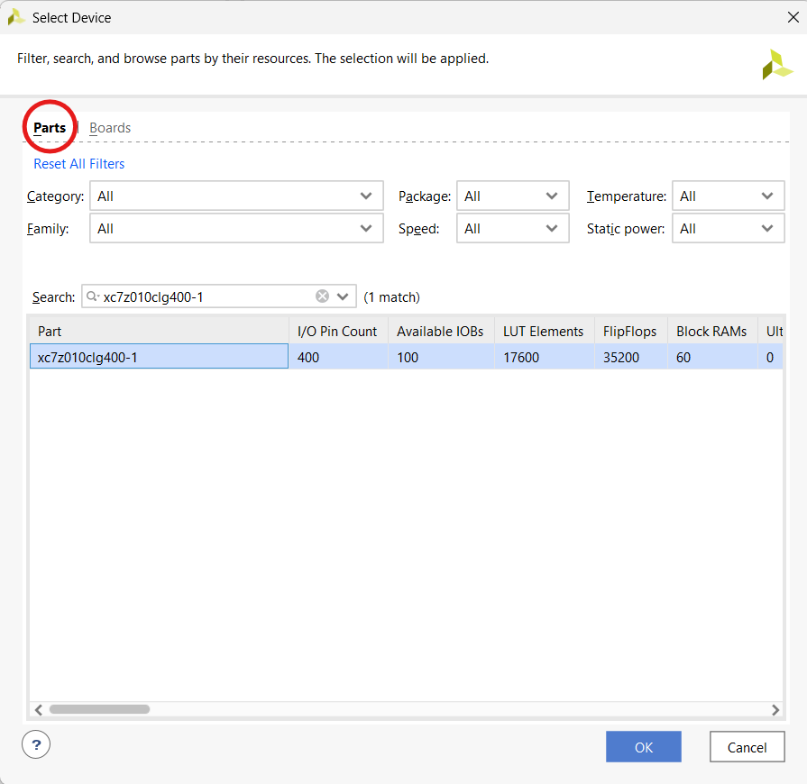
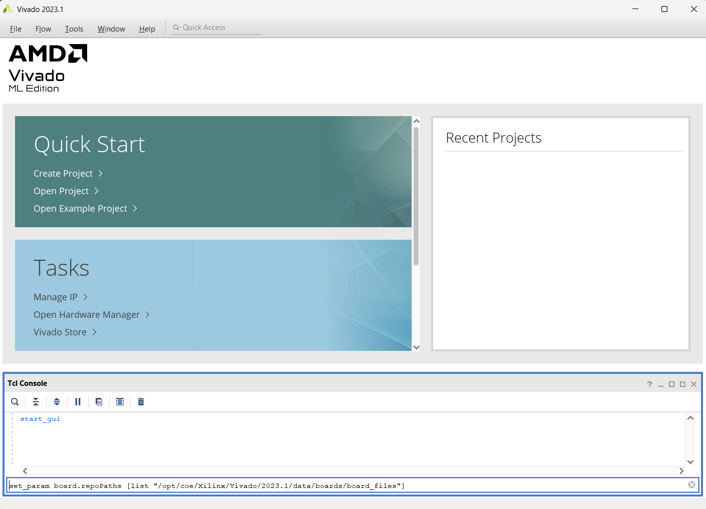

# Cannot Find Zybo-Board Trouble Shooting

If you cannot find the Zybo board in the list of board parts, there are a few possible fixes you can try below.

## 1. Restart Vivado

Exit Vivado and load it up again making sure not to press refresh when looking at the board parts. If this doesn't work, please try step 2.

## 2. Select the FPGA Equivalent Part
Instead of trying to find the Zybo board under "Boards", try looking for he equivalent FPGA part under "Parts" as show below.
The part ID is: 
```
xc7z010clg400-1
```
<p align='center'>
    
</p>


If this did not work, continue to step 3. 

## 3. Set the board path
In the tcl console, you can try entering the following command to force Vivado to point at the needed board files. See the image below to find out how to do this.
```tcl
set_param board.repoPaths [list "/opt/coe/Xilinx/Vivado/2023.1/data/boards/board_files"]
```

<p align='center'>
    
</p>


