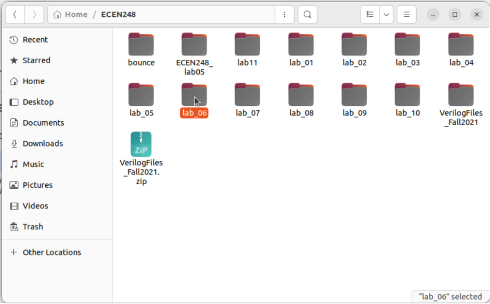
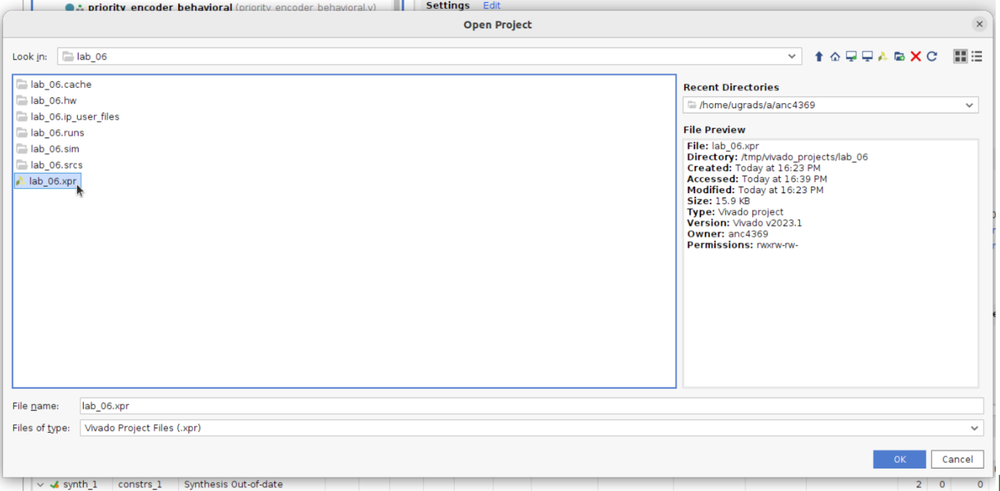

# Vivado Synthesis Trouble-Shooting

If you get an error or Vivado is stuck "queuing" when attempting to complete synthesis or bitstream generation, follow the steps below.

The error appears as an Input/Output error involving a path under .Xil/, for example:
```
Failed to close './.Xil/.../straps.rtd': Input/output error
```
If students see this or a similar error related to .Xil/, the workaround we found is to create the Vivado project under the /tmp directory instead of the home directory folloring the steps below.


## 1. Make a temporary project space in the `/tmp` directory
In the terminal, type the following command:
```sh
mkdir /tmp/vivado_projects_<yourNetID>
```
> *This folder will not persist across sessions.*

## 2. Copy your current project to the `/tmp` directory
You should have completed all the required code and simulation steps before moving your project over. The `/tmp/` directory will only be for synthesis/bitstream generation.

Open the file explorer and find your lab project folder. Right click on the project folder and select `copy`.

<p align='center'>
    
</p>

## 3. Paste your project in the `/tmp` directory
In the file explorer, navigate to `Other Locations` -> `Computer` -> `tmp` -> `vivado_projects_<yourNetID>`. Inside of the `vivado_projects_<yourNetID>` folder, right click and select `paste`.

## 4. Open the Copied project in Vivado
Navigate back to Vivado. In the top left of the screen go to `File` -> `project` -> `open`. In the open project window, type the project folder path.
```
/tmp/vivado_projects_<yourNetID>/<your_lab_project>
```

Double click on the `.xpr` file to open the project. 

<p align='center'>
    
</p>

## 5. Complete Synthesis Steps
At this point you will be working in a temporary copy of your project. Complete the synthesis (generate bitstream) and Zybo Board steps as instructed in the lab manual. 

## 6. Going Back to Your original project
When you are continuing to code, make sure to switch back to your original project folder; the /tmp/ directory does not save your files across sessions. You can use the flow in **step 4** to open your original project. Clicking on the House icon will automatically bring the navigator to your home directory.


